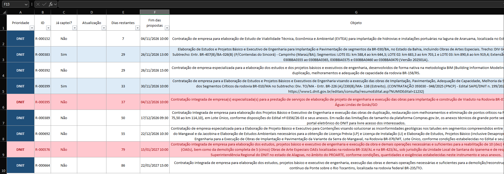
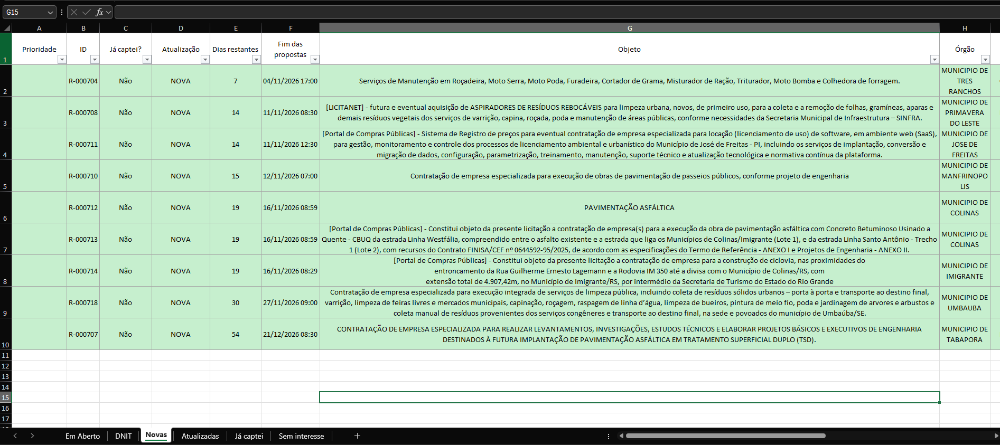
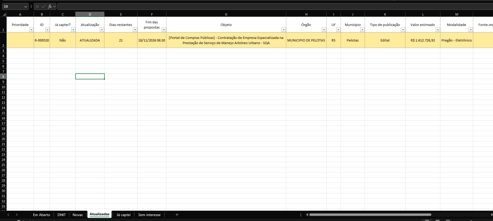
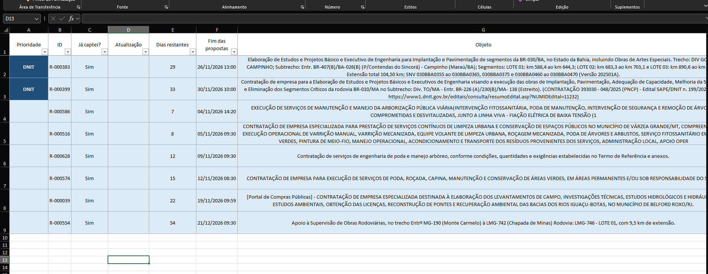
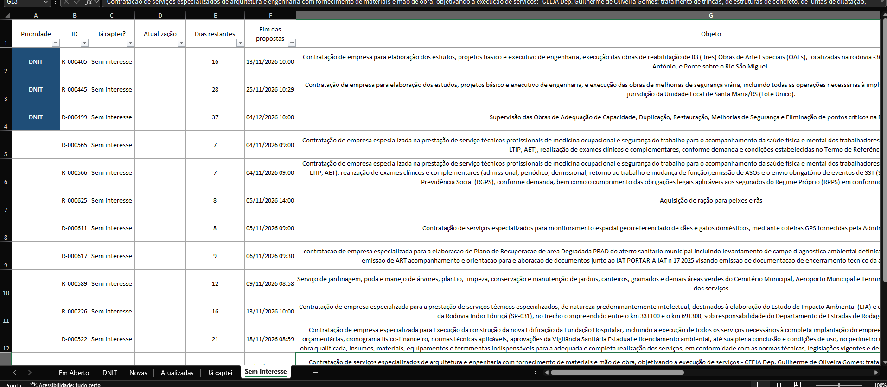

# Radar PNCP v5.1

Busca de oportunidades de licitação relacionadas a serviços ambientais, com classificação por palavras-chave e geração de planilhas Excel.

## Sobre o projeto

Criei o Radar como projeto de estudo em Engenharia de Software, a partir de uma necessidade que encontrei no trabalho: a busca e a triagem de licitações exigiam consultas manuais recorrentes.

O programa consulta dados públicos do Portal Nacional de Contratações Públicas (PNCP), identifica oportunidades relacionadas aos termos configurados e organiza os resultados em uma planilha. O objetivo é facilitar a primeira análise e o acompanhamento dos editais.

Durante o desenvolvimento, trabalhei com consumo de API, tratamento de JSON, paginação, persistência em SQLite e geração de relatórios com Python.

A rotina de coleta também conta com uma automação pelo GitHub Actions, mantida em um repositório privado.

## O que o Radar faz

- Consulta contratações com propostas abertas, nas UFs e modalidades definidas na configuração.
- Analisa o objeto da contratação e as informações complementares disponíveis.
- Classifica as oportunidades por termos e pontuação.
- Salva os registros em SQLite e acompanha alterações de situação e prazo.
- Gera uma planilha diária com filtros, destaques e links para os editais.
- Reaproveita as marcações de captação feitas na planilha.
- Guarda o progresso da coleta para permitir a retomada após interrupções.

Por padrão, a busca considera as 27 UFs e uma janela de até 90 dias a partir da data de execução.

## Como funciona a classificação

Os termos e seus pesos ficam em `configuracao.json`. A configuração inclui expressões relacionadas a licenciamento ambiental, estudos ambientais, recuperação de áreas degradadas, fauna, arqueologia e outras áreas técnicas.

| Peso | Uso na classificação |
| --- | --- |
| 3 | Termos mais específicos do foco da busca |
| 2 | Termos relevantes, que podem exigir contexto |
| 1 | Termos genéricos, insuficientes isoladamente |

Em geral, uma oportunidade precisa alcançar pelo menos dois pontos para ser mantida. O script também aplica regras de contexto e exclusão para reduzir resultados fora do foco, como compras de bens sem indicação de serviço e topografia isolada.

A classificação depende do texto recebido e das regras configuradas. A decisão sobre participar de uma licitação exige a leitura do edital e de seus anexos.

## A planilha

O relatório é salvo em `planilhas/DD.MM.AAAA.xlsx`, usando a data no horário de Brasília. Ele contém seis abas:

| Aba | Conteúdo |
| --- | --- |
| Em Aberto | Oportunidades dentro dos critérios de prazo |
| DNIT | Oportunidades identificadas como relacionadas ao DNIT |
| Novas | Oportunidades encontradas pela primeira vez no dia |
| Atualizadas | Oportunidades com alterações relevantes registradas |
| Já captei | Oportunidades marcadas como captadas |
| Sem interesse | Oportunidades marcadas para não acompanhar |

As colunas incluem objeto, órgão, UF, município, modalidade, valor estimado, situação, prazo restante, termos encontrados e link para o edital. O prazo mínimo padrão é de sete dias; situações suspensas ou canceladas recebem tratamento específico.

Na coluna **Já captei?**, é possível escolher **Não**, **Sim** ou **Sem interesse** em qualquer uma das seis abas. Salve e feche o Excel antes de executar o Radar novamente. O programa importa as edições das planilhas geradas pela versão atual e sinaliza marcações conflitantes para revisão.

### Exemplos dos resultados

**Em Aberto**



<details>
<summary>Ver outras abas</summary>

**Novas**



**Atualizadas**



**Já captei**



**Sem interesse**



</details>

## Tecnologias

- **Python 3.10** — linguagem e versão usada no projeto.
- **Requests** — consultas HTTP ao PNCP.
- **Pandas** — organização e transformação dos dados.
- **OpenPyXL** — geração e formatação das planilhas.
- **SQLite** — armazenamento local dos registros e do progresso.
- **GitHub Actions** — execução agendada da coleta no repositório privado.

O SQLite faz parte da biblioteca padrão do Python e dispensa a instalação de um servidor de banco de dados.

## Automação com GitHub Actions

Mantenho um repositório privado para executar a rotina de coleta e guardar o banco e as planilhas usados no acompanhamento. Nele, o workflow está configurado para dois horários diários:

| Horário de Brasília | Execução |
| --- | --- |
| 13h | Coleta normal, respeitando o progresso já registrado no dia |
| 18h | Nova varredura, consultando novamente todas as combinações de UF e modalidade |

O workflow prepara o Python, instala as dependências, executa o Radar e salva as atualizações no repositório privado. As planilhas são publicadas ali quando a coleta e a exportação terminam com sucesso. Também é possível iniciar a execução manualmente pela aba **Actions**.

Os agendamentos correspondem a 16h e 21h UTC. O início pode sofrer atrasos do GitHub Actions; os horários indicam a programação da rotina.

Este repositório público reúne o código, a configuração editável e exemplos visuais dos resultados. A automação operacional, o banco e as planilhas do acompanhamento ficam no privado.

## Como executar

Instale o Python 3.10, baixe o projeto e abra um terminal na pasta que contém o script. É necessário ter acesso à internet para a coleta.

Instale as dependências:

```bash
python -m pip install --require-hashes -r requirements.txt
```

Confira a configuração:

```bash
python radar_pncp_v5.1.py --validar-configuracao
```

Execute o Radar:

```bash
python radar_pncp_v5.1.py
```

Na primeira execução, o programa cria o banco `licitacoes_progaia.db`. Quando a coleta termina completa, cria a pasta `planilhas/`, se necessário, e grava o relatório do dia. Esses arquivos são gerados localmente; não é necessário baixar um banco ou uma planilha para começar.

Se a coleta terminar parcial ou falhar, o programa informa o problema no terminal e preserva a planilha anterior. O progresso já confirmado no banco pode ser reaproveitado na próxima execução.

### Refazer a coleta do dia

Para consultar novamente todas as combinações, sem apagar os registros e as marcações já salvos:

```bash
python radar_pncp_v5.1.py --nova-varredura
```

### Configuração editável

Edite o `configuracao.json` existente para ajustar os termos, pesos, filtros, UFs e modalidades. Mantenha a estrutura do arquivo e execute a validação após salvar as alterações.

Também é possível indicar outro arquivo de configuração:

```bash
python radar_pncp_v5.1.py --configuracao minha-configuracao.json
```

Se houver um problema na configuração, o Radar encerra a execução com uma mensagem de erro antes de iniciar a coleta.

## Estrutura do repositório

```text
Radar-de-Licitacoes-ambientais/
├── radar_pncp_v5.1.py
├── configuracao.json
├── requirements.txt
├── README.md
├── .gitignore
└── assets/
    └── readme/
```

O código e a configuração ficam disponíveis para estudo e adaptação. O banco e as planilhas são gerados durante o uso. As imagens em `assets/readme/` mostram exemplos da apresentação dos resultados.
