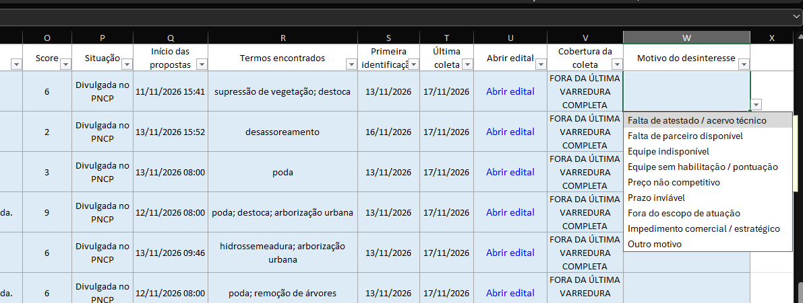
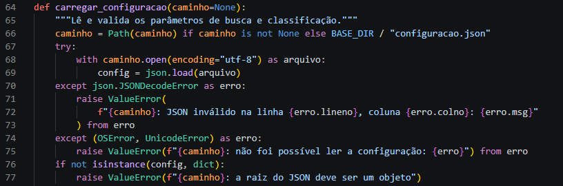
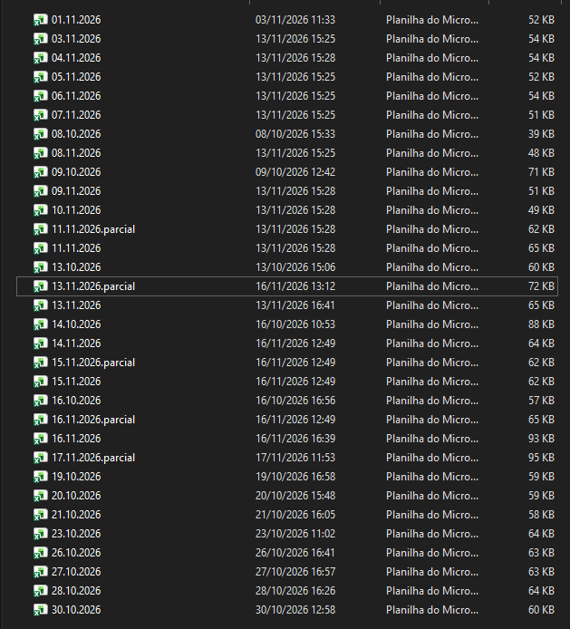
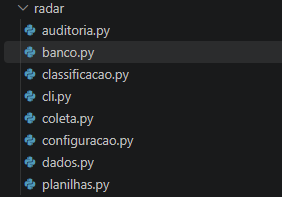

<h1 align="center">Radar de Licitações</h1>

<p align="center">Busca no PNCP, histórico em SQLite e triagem em Excel</p>

<p align="center"><strong>Python · Pandas · Requests · SQLite · OpenPyXL · GitHub Actions</strong></p>

Comecei o Radar para facilitar uma tarefa que fazia no trabalho, procurar licitações de serviços ambientais e de engenharia. A busca manual tomava tempo, então fui montando um programa em Python para consultar o PNCP e organizar as oportunidades em uma planilha.

Sou estudante de Análise e Desenvolvimento de Sistemas e tenho usado o projeto para aprender na prática. Conforme a equipe foi usando os resultados, apareceram ajustes nos filtros, nas marcações e na forma de lidar com as falhas da API.

## Como funciona

O Radar consulta a API pública do Portal Nacional de Contratações Públicas por estado e modalidade. Ele procura termos no objeto e nas informações complementares, aplica as regras de classificação e salva os registros em SQLite.

A planilha reúne as oportunidades em abas como Em Aberto, Novas, Atualizadas, Já captei e Sem interesse. Ela mostra os prazos, valores, situação e o link do edital. As marcações feitas pela equipe podem ser importadas para o banco e reaproveitadas na próxima execução.

## O que mudou com o uso

### Motivo do desinteresse

Antes, a gente marcava que não tinha interesse em uma oportunidade, mas depois faltava saber o motivo. Acrescentei uma lista na planilha para registrar essa decisão. O motivo fica salvo no banco junto da marcação e aparece nas próximas atualizações.



### Validação do JSON

Os termos e pesos da busca ficam em `configuracao.json`. Depois de compartilhar essa mudança, recebi um comentário sobre o risco de um arquivo incorreto acabar parecendo um dia sem oportunidades.

Incluí a validação antes da coleta. Se o arquivo não puder ser lido ou estiver com a estrutura incorreta, o programa mostra o erro e interrompe a execução. Também são conferidos os campos obrigatórios, os termos e os pesos. O print mostra a parte da leitura e do tratamento de erros do arquivo.



### Planilhas completas e parciais

A API nem sempre responde como esperado. Quando uma consulta esgota as tentativas, o Radar registra o que ficou pendente e segue para as próximas. Se a busca ficar incompleta, gera um arquivo com `.parcial.xlsx` no nome, separado da planilha completa.

Também é possível retomar a rodada do dia. Assim, uma falha na consulta fica identificada e pode ser tratada depois.

<p align="center"></p>

### Organização do código

Conforme fui acrescentando funções, ficou mais trabalhoso mexer em tudo dentro de um arquivo só. Separei coleta, classificação, banco e planilhas em módulos. O arquivo `radar_pncp_v5.1.py` continua sendo a entrada para executar o programa.

<p align="center"></p>

Os filtros também foram sendo revisados. Um caso foi a sigla EIA, que aparece tanto em estudos ambientais quanto em especificações de cabeamento. Ajustei as regras para considerar o contexto e acrescentei testes para esses casos.

## Como rodar

Os workflows usam Python 3.10. No Windows, abra o terminal na pasta do projeto e crie um ambiente virtual.

```powershell
py -3.10 -m venv .venv
```

Instale as dependências e confira a configuração.

```powershell
.\.venv\Scripts\python.exe -m pip install --require-hashes -r requirements.txt
.\.venv\Scripts\python.exe radar_pncp_v5.1.py --validar-configuracao
```

Para iniciar a coleta, execute o comando abaixo. O banco `radar.db` e a pasta `planilhas` são criados pelo programa.

```powershell
.\.venv\Scripts\python.exe radar_pncp_v5.1.py
```

A configuração inicial consulta as 27 UFs e cinco modalidades, com uma janela de até 90 dias. A rodada tem limite padrão de 90 minutos. Para experimentar com uma busca menor, altere as UFs no JSON antes de começar.

Para continuar uma rodada pendente do dia, use `--retomar`. Para recomeçar a busca, use `--nova-varredura`. Com `--somente-excel`, o Radar gera a planilha a partir de um banco já preenchido, sem consultar a API.

## Ajustar a busca e salvar marcações

O JSON reúne os termos, pesos, exclusões, UFs e modalidades. Os pesos aceitos são 1, 2 e 3. A configuração atual é voltada a serviços ambientais e de engenharia. Algumas regras de contexto e prioridade ficam no código e precisam ser revistas se a ideia for adaptar o projeto a outro setor.

Na coluna Já captei?, escolha Não, Sim ou Sem interesse. Salve e feche a planilha antes de importar as alterações. Troque `ARQUIVO.xlsx` pelo nome do arquivo que você editou.

```powershell
.\.venv\Scripts\python.exe radar_pncp_v5.1.py --somente-excel --importar-marcacoes "planilhas/ARQUIVO.xlsx"
```

As mudanças ficam no histórico do banco. Os editais marcados como captados continuam em Acompanhamento, mesmo depois do prazo das propostas, e recebem novas consultas de situação no PNCP.

## Testes

Os testes cobrem classificação, validação do JSON, banco, importação de marcações, exportação do Excel e tratamento de falhas. As consultas externas são bloqueadas durante os testes, que usam dados de exemplo e bancos temporários ou em memória.

```powershell
.\.venv\Scripts\python.exe -m pip install --require-hashes -r requirements-dev.txt
.\.venv\Scripts\python.exe -m pytest -q
```

No GitHub, as verificações rodam em pushes e pull requests. Além dos testes, há uma etapa para conferir as dependências.

## Execução pelo GitHub Actions

Nesta versão pública, a coleta é manual. Na aba Actions, abra Coleta manual do Radar e escolha Run workflow. O banco e as planilhas gerados ficam disponíveis para download nos artefatos da execução por três dias. Se a coleta ficar parcial, os arquivos produzidos são preservados e a execução termina sinalizada como falha.

Cada execução no Actions começa com um banco novo. Para manter histórico e marcações entre dias, execute localmente usando o mesmo banco. O agendamento diário usado na operação não está ativado nesta cópia.

## Sobre esta versão

As capturas mostram o Radar em uso. O repositório contém o código e a configuração, sem banco preenchido, planilhas da operação ou documentos da empresa.

O Radar ajuda a encontrar e organizar oportunidades. A leitura do edital e dos anexos e a decisão de participar continuam com a equipe. A classificação depende do texto recebido da API e pode precisar de revisão. A cobertura mostrada no resumo indica quanto da coleta foi concluído, sem representar a precisão dos filtros.
