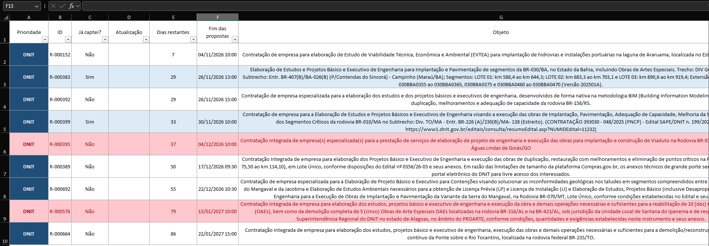
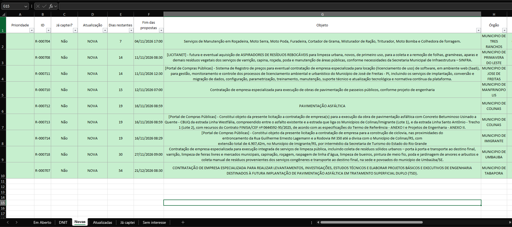
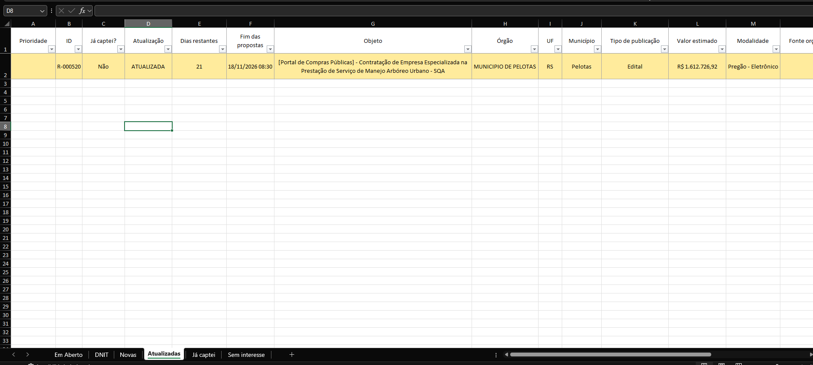
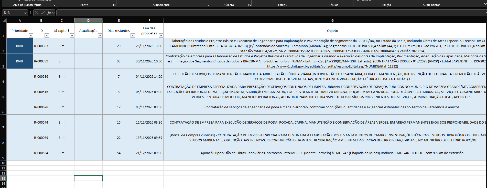
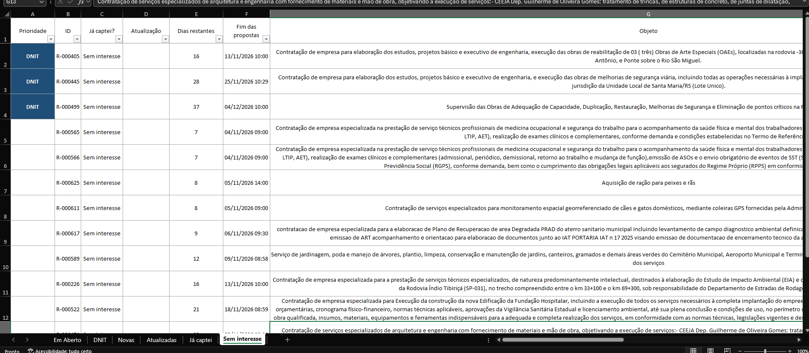

# Radar de Licitações Ambientais

Um projeto pessoal para encontrar e organizar oportunidades de licitação relacionadas a serviços ambientais e de engenharia no Portal Nacional de Contratações Públicas (PNCP).

## Como esse projeto começou

Tenho 18 anos, sou jovem aprendiz na Progaia e estou no segundo semestre de Engenharia de Software. Queria aprender mais sobre APIs e, ao mesmo tempo, percebi que a busca por editais na empresa tomava bastante tempo.

Fui pesquisar se havia uma API que pudesse ajudar e encontrei a do PNCP. Comecei a testar aos poucos e priorizei oportunidades do DNIT, órgão com o qual a Progaia já tem relacionamento. Com a ajuda dos analistas de licitações, defini um critério importante: o Radar descarta oportunidades com menos de sete dias para o fim do prazo, porque esse tempo costuma ser curto para analisar o edital e preparar uma proposta.

O projeto nasceu para facilitar a busca e a triagem. Ele não decide se uma oportunidade serve para a empresa: essa avaliação continua dependendo da leitura do edital e da equipe.

## O que o Radar faz

- Consulta oportunidades com propostas abertas na API pública do PNCP, em todas as UFs e modalidades configuradas.
- Compara os textos das oportunidades com palavras-chave relacionadas ao foco ambiental e de engenharia.
- Salva os dados e as mudanças observadas em um banco SQLite.
- Gera uma planilha Excel diária, organizada em abas como **Em Aberto**, **DNIT**, **Novas**, **Atualizadas**, **Já captei** e **Sem interesse**.
- Mantém as marcações feitas na coluna **Já captei?** entre as execuções.

O Radar olha até 90 dias à frente. Na planilha, as oportunidades aparecem com informações como prazo, órgão, município, valor estimado, termos encontrados e link para o edital.

## Como funciona a pontuação

As palavras-chave têm pesos diferentes: termos mais específicos valem mais pontos; termos mais amplos valem menos e precisam de contexto. O Radar também considera informações complementares da API e dados do órgão ou da unidade para avaliar alguns termos.

No começo, percebi que resultados com pontuação 1 traziam falsos positivos demais. Na versão atual, a pontuação mínima é 2. Também há filtros para reduzir resultados que parecem compras de bens ou que mencionam topografia sem outros sinais de um serviço relacionado. São critérios automáticos de triagem, então ainda podem ocorrer falsos positivos ou oportunidades relevantes que não sejam encontradas.

## A planilha

As imagens abaixo mostram algumas das abas geradas pelo Radar:

<p align="center">
  
  <br><em>Em Aberto: oportunidades ordenadas para facilitar a triagem.</em>
</p>

<p align="center">
  
  <br><em>Novas: oportunidades identificadas pela primeira vez.</em>
</p>

<p align="center">
  
  <br><em>Atualizadas: oportunidades com mudanças relevantes.</em>
</p>

<p align="center">
  
  <br><em>Já captei: acompanhamento das oportunidades que a equipe decidiu captar.</em>
</p>

<p align="center">
  
  <br><em>Sem interesse: oportunidades que não precisam continuar na triagem.</em>
</p>

## Um pouco da evolução

Guardei as etapas anteriores na pasta `HISTORICO/`. A ideia era experimentar, observar os resultados e ajustar o Radar com o uso:

- **Primeiras versões:** comecei a consultar o PNCP e a testar a classificação por palavras-chave. Logo vieram a pontuação por relevância, o registro de todas as palavras encontradas e a identificação de oportunidades novas.
- **Versões seguintes:** fui organizando melhor as planilhas, o histórico das oportunidades e a retomada de coletas interrompidas. Também refinei o uso do contexto para reduzir resultados que não tinham relação com o foco do Radar.
- **v4:** consolidou regras de classificação, a organização das abas e o prazo mínimo de sete dias.
- **v5 (atual):** passou a considerar também a informação complementar da API, ampliou os termos ambientais e aumentou a pontuação mínima de 1 para 2 para reduzir falsos positivos. A opção `--nova-varredura` permite refazer a coleta do dia.

Para usar a versão atual, execute o arquivo `radar_pncp_v5.py` na raiz do projeto. Os scripts dentro de `HISTORICO/` são versões anteriores.

## Como executar

Você vai precisar de Python 3 e acesso à internet. Instale as dependências:

```bash
python -m pip install requests pandas openpyxl
```

Para iniciar uma coleta:

```bash
python radar_pncp_v5.py
```

Para refazer todas as combinações de estados e modalidades no mesmo dia:

```bash
python radar_pncp_v5.py --nova-varredura
```

Na execução normal, se uma coleta for interrompida, o Radar registra o progresso e tenta continuar de onde parou na próxima execução. Antes de rodar o programa de novo, salve e feche a planilha do Excel para que as marcações possam ser importadas.

## Arquivos principais

- `radar_pncp_v5.py`: código da versão atual.
- `tests/`: testes da coleta e da classificação.
- `assets/readme/`: imagens de exemplo das planilhas.
- `HISTORICO/`: versões anteriores e materiais de desenvolvimento.

O banco SQLite e as planilhas diárias são criados localmente durante o uso. As imagens deste README servem apenas para mostrar como o resultado fica.

## Tecnologias e aprendizados

Python, API REST, JSON, paginação, tratamento de falhas, SQLite, pandas e Excel. Foi também um exercício prático de transformar uma necessidade do dia a dia em uma ferramenta que pode ser testada e melhorada aos poucos.

## Limitações

O resultado depende das informações publicadas no PNCP e das palavras-chave configuradas. Por isso, uma oportunidade pode passar despercebida ou aparecer mesmo sem ser adequada. Consulte sempre o PNCP, o edital e seus anexos antes de tomar qualquer decisão.
